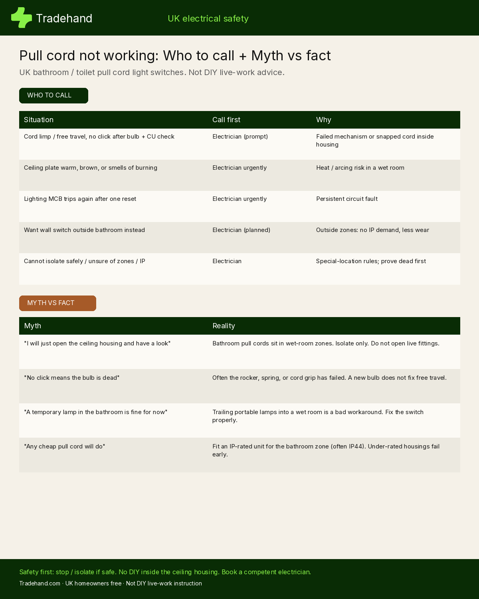

Bathroom pull cord dead overnight? Here are the UK safe checks to run before you open anything, for homeowners who reached for the dangling cord and got nothing.

A limp cord with free travel, a silent pull with no click, or a light that stays off after a new bulb are the usual patterns. Most of the time the fault is local: a worn mechanism, a cord snapped inside the housing, a failed lamp, or a lighting MCB that tripped once. Bathroom steam and years of pulls wear these switches. None of that is a reason to open a live ceiling fitting with wet hands nearby.

*Written by Sol Wright, Tradehand. General safety information for UK homes. Not DIY electrical instruction.*

## What a healthy pull cord should feel like

A UK bathroom or toilet pull cord is a ceiling-mounted switch with an insulating cord so wet hands never touch a wall plate. Pull slowly. You should feel light resistance, then a clear click as the rocker flips. If the cord slides freely, feels floppy, or makes no sound, the mechanism or the cord grip inside the housing has usually failed. If it clicks but the room stays dark, the next suspects are the bulb, the lamp holder, or the lighting circuit.

Other lights in the house can still work while this one is dead. That points to a local fault at the cord, the rose, or the lamp, not a whole-house mystery.

## First five minutes (nothing opened)

1. **Keep wet hands off the fitting.** Do not stand on the bath edge to yank harder. Extra force will not revive a failed spring or a snapped internal cord.
2. **Check the consumer unit.** Look for a tripped lighting MCB. Reset once only. If it trips again straight away, stop and book an electrician.
3. **Fit a known-good bulb.** Seat bayonet bulbs fully. Bathroom bulbs often fail with little or no blackening on the glass.
4. **Pull slowly and listen.** Click with light still dead after a new bulb usually means the rose, holder, or wiring beyond the switch. Free travel with no click usually means the switch itself.
5. **Cord string only, if that is what snapped.** You may replace the dangling string below the ceiling plate. Do not open the switch housing.
6. **Heat, brown staining, or a burning smell.** Isolate the lighting circuit if the consumer unit is dry and safe to reach, keep people clear, and call an electrician. Do not trail extension leads or portable lamps into a wet room as a workaround.

## Why bathroom pull cords fail

Humidity, weak extractors, and daily use wear the rocker, spring, contacts, and cord grip. Common matches:

- Worn rocker or spring (no click after years of use)
- Cord snapped inside the housing (free travel, no resistance)
- Corroded contacts from bathroom steam
- Loose connections at the ceiling unit
- Faulty rose or lamp holder (click present, light still dead after a new bulb)
- Tripped lighting MCB
- Moisture into an under-rated or ageing housing
- Worn cord grip (cord slips without engaging the mechanism)

Any of these can leave the bathroom dark while the landing light still works.

## Is a dead pull cord dangerous?

A cord that simply will not turn the light on is not usually an immediate emergency on its own. Bathroom electrics still sit under UK zone and IP rules, so treat the fitting with respect. Warm fittings, a burning smell, melting plastic, or a brown ring around the ceiling plate are different. Isolate if safe, then call an electrician. Do not open the housing to "have a look" unless you are competent to isolate and prove dead.

## Who to call

| Situation | Who to call | Urgency |
|---|---|---|
| Cord limp / free travel, no click after bulb and CU check | Electrician | Prompt |
| Ceiling plate warm, brown, or smells of burning | Electrician | Urgent |
| Lighting MCB trips again as soon as you reset it | Electrician | Urgent |
| Several lights on the same circuit are out | Electrician | Prompt |
| You want a wall switch outside the bathroom door | Electrician | Planned |
| You need an IP-rated replacement for the bathroom zone | Electrician | Planned |
| Someone hurt by shock or burn from the fitting | 999 | Immediately |

Who to call is almost always a local electrician. This is not a plumber job, and heat or a burning smell is not a "wait and see" issue. Ask them to isolate, prove dead, fit a suitable IP-rated unit for the zone, and test before leaving.

## Myths that keep people opening live housings

- **"I will just take the cover off and see."** Opening a live ceiling housing in a wet room is how people get hurt. Isolate and prove dead first, or leave it to an electrician.
- **"Yank harder and it will click."** Extra force can snap the remaining cord or damage the mechanism further. It will not repair a failed spring.
- **"Any spare switch will do."** Bathroom positions need a rating that fits the zone. Many bathroom pull cords are IP44. An under-rated unit lets steam in and fails again sooner.
- **"I will use a lamp on an extension until I get round to it."** Portable lamps and trailing leads in a wet room are a poor temporary fix. Fix the switch, or fit a wall switch outside the door.

## Bathroom zones, IP ratings, and Part P (brief)

BS 7671 splits bathrooms into zones. Equipment needs a rating that fits where it sits. When the electrician replaces a dead pull cord, they should fit a unit rated for that position.

In England, Part P notification depends on the scope of the work and whether it sits in special-location zones. A like-for-like replacement is not automatically notifiable solely because the room is a bathroom. A new circuit or alterations inside zones often are. Check current Approved Document P or ask Building Control when unsure. Keep any certificates or test records the electrician supplies.

## Often better: a wall switch outside the door

If your pull cord keeps failing, a wall switch outside the bathroom door is a common lasting fix. Outside the zones there is no IP demand on that plate, less mechanical wear, and easier daily use. Motion or smart switches outside the room are other options your electrician can discuss. Many homeowners swap the second or third time a pull cord goes floppy after years of steam and a weak fan.

## Neighbour scenes

- Ensuite with no working fan: cord goes floppy, then one morning there is no click.
- Toilet under the stairs: bulb change fixes it half the time; otherwise the cord slides freely and the switch needs replacing.
- Brown staining around the ceiling plate: stop, isolate if safe, do not trail temporary lamps into the wet room.

## If you rent, or you are the landlord

- **Tenants:** tell your landlord or agent in writing (time, no click / limp / heat / smell). No temporary lamps in the wet room.
- **Landlords and agents:** treat heat, burning smell, or a repeatedly tripping MCB as urgent. For a simple limp cord, book an electrician promptly and keep the report.
- **Flats:** tell the managing agent if lighting is shared, and ask neighbours about similar failures.

## What the visit usually involves

An electrician will isolate the lighting circuit, prove it dead, and check the mechanism, cord grip, connections, and often the rose or lamp holder. They should fit an IP-rated replacement for the bathroom zone, or a wall switch outside the door if that is the better lasting fix, then test before leaving. Ask for a quote for your specific job.

## One-minute checklist

- Wet hands off. No standing on the bath to yank harder.
- Lighting MCB: reset once. Trips again? Stop and call an electrician.
- New bulb, seated properly.
- Pull slowly. No click / free travel after those checks? Book an electrician.
- Warm plate, brown staining, or burning smell? Isolate if safe and call urgently.
- Cord string below the plate only if that string snapped. Housing stays closed.
- Prefer a lasting fix? Ask about a wall switch outside the bathroom door.

## Further reading

For the full walkthrough of causes, safe checks, and when to book, see Tradehand's guide to a [pull cord not working](https://tradehand.com/problems/light-switches/pull-cord-not-working?utm_source=github_pages&utm_medium=parasite&utm_campaign=problems). There is also a short public checklist as a [Google Doc](https://docs.google.com/document/d/16q9DrS9BkyeYi3z5gsWV32xisL9vs4vXh9G5UrRdJs4/view?usp=sharing).

If you do not have someone you trust, [Tradehand](https://tradehand.com/?utm_source=github_pages&utm_medium=parasite&utm_campaign=problems) is free for homeowners to post a job and hear from local electricians.

*Written by Sol Wright at Tradehand. Last reviewed October 2026. If in doubt, isolate if safe, leave the housing closed, and call a qualified electrician.*
